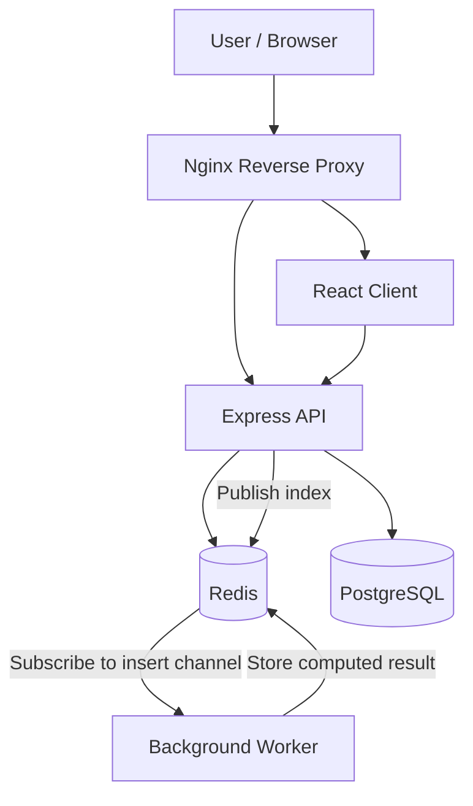

# Multi-Container Application

A containerized, multi-service web application that demonstrates asynchronous computation, inter-service communication, and persistent data storage using Docker, React, Node.js, PostgreSQL, and Redis.

## Overview

This project implements a distributed-style application for calculating Fibonacci values. Users can submit an index through a web interface, the API records the request, and a dedicated worker calculates the result asynchronously. Redis is used to coordinate work and cache computed values, while PostgreSQL stores submitted indices.

The application is split into independently containerized services, each with a distinct responsibility.

## Architecture



### Services

| Service | Responsibility | Technology |
|---|---|---|
| Client | Web interface for submitting and viewing Fibonacci calculations | React |
| API | HTTP endpoints, request validation, persistence, and work dispatch | Node.js, Express |
| Worker | Asynchronous Fibonacci computation | Node.js |
| Cache and messaging | Stores computed results and distributes work through Redis pub/sub | Redis |
| Database | Persists submitted Fibonacci indices | PostgreSQL |
| Reverse proxy | Routes incoming traffic to application services | Nginx |
| Orchestration | Defines and runs the multi-container environment | Docker Compose |

## How it works

1. **Submit:** A user submits a Fibonacci index through the web client.
2. **Validate:** The API rejects indices greater than the configured limit of 40.
3. **Persist:** The API stores the submitted index in PostgreSQL.
4. **Dispatch:** The API publishes the index to a Redis channel.
5. **Compute:** The background worker subscribes to the channel and calculates the Fibonacci value.
6. **Cache:** The worker stores the result in Redis.
7. **Retrieve:** The client can request previously submitted indices and computed results through the API.

This separation keeps computation outside the HTTP request handler and demonstrates a basic asynchronous processing pattern.

## Technology Stack

- **JavaScript / Node.js** — server-side application logic
- **React** — client-side interface
- **Express** — REST API
- **PostgreSQL** — persistent relational storage
- **Redis** — caching and publish/subscribe messaging
- **Docker** — service containerization
- **Docker Compose** — local multi-service orchestration
- **Nginx** — reverse proxy and request routing
- **GitHub Actions** — workflow configuration

## Getting Started

### Prerequisites

- Docker
- Docker Compose
- Git

### Run locally

Clone the repository:

```bash
git clone https://github.com/mateusgpedro/multi-container-project.git
cd multi-container-project
```

Build and start the development environment:

```bash
docker compose -f docker-compose-dev.yml up --build
```

The development Compose configuration defines the client, API, worker, Nginx, PostgreSQL, and Redis services.

Open the application at:

**http://localhost:3050**

To stop the services:

```bash
docker compose -f docker-compose-dev.yml down
```

To stop the services and remove their Compose-managed volumes, if any:

```bash
docker compose -f docker-compose-dev.yml down -v
```

> **Note:** The development configuration includes local database credentials for development use. Do not reuse these credentials in production. If startup fails, check the Docker logs and confirm that all services have started successfully.

## API Reference

The Express API exposes the following routes:

| Method | Endpoint | Description |
|---|---|---|
| `GET` | `/` | Basic API response |
| `GET` | `/values/all` | Retrieve submitted indices from PostgreSQL |
| `GET` | `/values/current` | Retrieve computed values currently stored in Redis |
| `POST` | `/values` | Submit an index for asynchronous calculation |

### Submit a calculation

```http
POST /values
Content-Type: application/json
```

Request body:

```json
{
  "index": 10
}
```

A valid request is acknowledged with a response indicating that processing has been initiated. The calculation is performed by the worker rather than directly in the request handler.

Indices greater than 40 are rejected with HTTP `422 Unprocessable Entity`.

## Engineering Concepts Demonstrated

### Service separation

The application separates HTTP handling, background computation, persistent storage, caching, and request routing into distinct services.

### Asynchronous processing

Redis pub/sub provides a simple mechanism for communicating between the API and the worker without requiring the API to calculate Fibonacci values itself.

### Persistent versus transient data

PostgreSQL stores submitted indices, while Redis holds computed results for fast retrieval. This illustrates the different roles of a relational database and an in-memory data store.

### Containerized development

Docker Compose brings the application's services together in a reproducible local environment, reducing the need to install each infrastructure dependency directly on the host machine.

### Reverse proxying

Nginx provides an entry point for routing requests to the relevant application services.

## Limitations and Future Improvements

This project is a learning project that demonstrates multi-container application architecture and asynchronous processing. It is not intended to be a production-grade job-processing platform.

Potential improvements include:

- Replace Redis pub/sub with a durable queue if jobs must survive worker downtime.
- Add retries, explicit job states, and error handling for failed calculations.
- Add health checks and service readiness handling.
- Validate input types and reject negative or non-integer indices.
- Add automated unit and integration tests.
- Add structured logging and monitoring.
- Use environment-based configuration and secrets management.
- Pin dependency and container image versions.
- Add CI checks for building and testing each service.

These improvements would make the system more resilient and easier to operate under failure.

## What I Learned

This project explores how a web application can be decomposed into multiple services with separate responsibilities. It also provides practical experience with Docker Compose, HTTP APIs, Redis-based messaging, background computation, PostgreSQL, and reverse-proxy configuration.

## Author

**Mateus Pedro**

- GitHub: [@mateusgpedro](https://github.com/mateusgpedro)
- Repository: [multi-container-project](https://github.com/mateusgpedro/multi-container-project)
