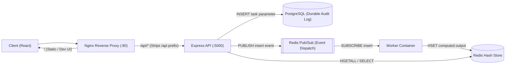

# Distributed Asynchronous Task Engine

A containerized, multi-service backend and web architecture that demonstrates asynchronous task dispatch, bounded background computation, reverse-proxy routing, and dual-storage persistence using Docker, Node.js, Express, React, PostgreSQL, Redis, and Nginx.

## System Architecture

**Request & Event Flow:**
`Client (React) → Nginx Reverse Proxy (:80) → Express API (:5000) → PostgreSQL (Durable Audit Log) + Redis Pub/Sub (Event Dispatch) → Worker Container → Redis Hash Store`



### Services Overview

| Service | Responsibility | Technology |
|---|---|---|
| **Nginx Reverse Proxy** | Single entry point (`:80`), routes `/` to React client and `/api/*` to Express API | Nginx |
| **Client** | Dashboard for submitting task parameters, viewing PostgreSQL audit records, and inspecting Redis results | React |
| **Express API** | Strict input validation, relational audit logging, event publication, and healthcheck reporting | Node.js, Express |
| **Worker** | Subscribes to task events, executes bounded $O(n)$ computation, and writes results with `SIGTERM` graceful shutdown | Node.js |
| **PostgreSQL** | Durable relational audit log of all submitted task parameters | PostgreSQL 15 |
| **Redis** | Low-latency Pub/Sub message broker and in-memory hash store for computed task outputs | Redis 7 |

## Dual-Storage Design Rationale

This system intentionally separates **durable audit state** from **transient execution state**:

- **PostgreSQL (Durable Relational Audit Log):** Stores a permanent, append-only relational record (`values` table) of every valid task parameter submitted to the system. Even if the in-memory cache is flushed or restarted, the historical record of requested tasks remains intact.
- **Redis (Message Broker & Fast Key-Value Store):** Serves a dual role as the low-latency Pub/Sub dispatch channel (`insert`) between the API and worker processes, and as an O(1) in-memory hash table (`values`) holding the latest computed output for each task parameter.

## Getting Started

### Prerequisites

- Docker & Docker Compose

### Run Locally

1. Clone the repository:

```bash
git clone https://github.com/mateusgpedro/distributed-async-task-engine.git
cd distributed-async-task-engine
```

2. (Optional) Copy the environment variable template:

```bash
cp .env.example .env
```

3. Build and start the multi-container environment:

```bash
docker compose up --build
```

For hot-reloading during local development:

```bash
docker compose -f docker-compose-dev.yml up --build
```

4. Access the application at **http://localhost:3050**.

To stop the containers and remove volumes:

```bash
docker compose down -v
```

## API Reference

Nginx routes requests prefixed with `/api/*` to the Express API by stripping the `/api` prefix:

| Method | Endpoint (via Nginx) | Express Route | Description |
|---|---|---|---|
| `GET` | `/api/health` | `/health` | Verifies PostgreSQL query execution (`SELECT 1`) and Redis connectivity |
| `GET` | `/api/values/all` | `/values/all` | Retrieves all submitted task parameters from PostgreSQL |
| `GET` | `/api/values/current` | `/values/current` | Retrieves all computed key-value pairs stored in Redis |
| `POST` | `/api/values` | `/values` | Validates and submits a task parameter for asynchronous execution |

### Submit a Task

```http
POST /api/values
Content-Type: application/json

{
  "index": 10
}
```

- **`200 OK`**: `{ "working": true }` — Task parameter persisted to PostgreSQL and dispatched to Redis.
- **`400 Bad Request`**: `{ "error": "Invalid task parameter" }` — Non-integer or negative payload rejected.
- **`422 Unprocessable Entity`**: `{ "error": "Index too high" }` — Parameter exceeds the configured bound (`40`).

## Engineering Trade-offs & Future Production Hardening

To keep the local multi-container footprint lightweight and self-contained, this repository uses Redis Pub/Sub and client-triggered fetches. For a high-throughput production deployment, the following architectural upgrades apply:

- **Durable Work Queues over Redis Pub/Sub:** Redis `PUBLISH`/`SUBSCRIBE` provides *at-most-once* delivery (fire-and-forget: if a worker is offline during publish, the message is dropped; if multiple workers subscribe, every worker computes the same message). In production, replace Pub/Sub with **Redis Streams**, **BullMQ** (`LPUSH`/`BRPOP`), or **RabbitMQ** for *at-least-once* delivery, competing consumer worker pools, exponential backoff retries, and dead-letter queues (DLQ).
- **Server Push over Client Polling:** Replace manual client fetches with **Server-Sent Events (SSE)** or **WebSockets** so the API pushes state transitions to the browser immediately when the worker completes a job.
- **Idempotency Keys on Task Submission:** Add an `Idempotency-Key` header or unique constraint on `POST /api/values` so duplicate network retries do not trigger redundant PostgreSQL writes or duplicate worker dispatches.
- **Explicit Job Lifecycle State Machine:** Expand the Redis hash value into structured lifecycle metadata (`PENDING` → `PROCESSING` → `COMPLETED` / `FAILED`) with timestamps and worker heartbeats to detect stalled tasks.

## Author

**Mateus Pedro**

- GitHub: [@mateusgpedro](https://github.com/mateusgpedro)
- Repository: [distributed-async-task-engine](https://github.com/mateusgpedro/distributed-async-task-engine)
